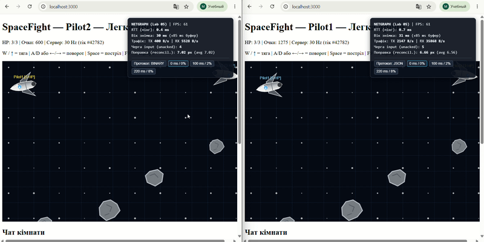

# Lab 01 — The Event Loop Is the Game Loop

## SpaceFight

A small browser space game built with JavaScript and Canvas 2D.

## Implemented

- `requestAnimationFrame` game loop
- Fixed timestep simulation at 60 Hz
- Accumulator
- Interpolation
- Keyboard input using a closure
- `isDown()` and `justPressed()`
- Ship movement and rotation
- Wrap-around arena
- Canvas 2D rendering
- DPR-aware and resizable canvas
- Grid and starfield
- HUD with Steps/s, Frames/s and Frame time
- Rocket thrust and smoke
- Boost mode after holding W for more than 2 seconds

## Project structure

- `loop.js` — game loop and fixed timestep
- `input.js` — keyboard input
- `sim/ship.js` — ship simulation
- `sim/arena.js` — wrap-around
- `render/canvas.js` — Canvas setup and resizing
- `render/draw.js` — game rendering

## Fixed timestep

The simulation uses a fixed timestep of `1 / 60` seconds.

The accumulator allows the simulation to perform the required number of fixed updates independently from the rendering frame rate.

Interpolation is used to make the rendered movement smoother.

## Experiments

### Experiment 1 — Synchronous blocking

A synchronous `busyWait` of approximately 100 ms was intentionally added to the main thread.

Observed result:

- Busy wait: approximately **100 ms**
- Steps/s: approximately **55–60**
- Rendering became visibly less smooth during the blocking operation.

Conclusion:

JavaScript synchronous code runs on the main thread. While the busy loop is executing, the browser cannot process rendering and other main-thread work normally.

### Experiment 2 — setInterval vs requestAnimationFrame

The game loop was temporarily changed from `requestAnimationFrame` to `setInterval`.

Measured over approximately 10 seconds:

- `requestAnimationFrame`: **60.05 FPS**
- `setInterval`: **57.00 FPS**
- Average `setInterval` interval: **17.54 ms**
- After switching to another browser tab for approximately 5 seconds: **30.79 FPS**

Conclusion:

`requestAnimationFrame` is designed for browser rendering and synchronizes animation work with the browser's rendering cycle. `setInterval` does not provide the same rendering-oriented scheduling behavior.

### Experiment 3 — Variable timestep

The accumulator and fixed timestep were temporarily removed and the simulation was changed to use the real frame `deltaTime`.

With CPU throttling set to **6×**, the ship was moved by holding W for approximately 5 seconds.

Measured results:

| Mode | X | Vx |
|---|---:|---:|
| Variable timestep | 672.83 | 31.69 |
| Fixed timestep | 751.56 | 12.09 |

The final X positions differed by approximately **78.73 px**.

Conclusion:

The amount of simulation work performed per frame affects the result when using a variable timestep, especially when frame timing changes under CPU load. A fixed timestep keeps simulation updates at a constant `1/60` second step and makes the simulation more predictable.

## Reflection

### Why does a synchronous busy loop freeze the page?

JavaScript executes synchronous code on the main thread. While a synchronous loop is running, the browser cannot process rendering, input or other tasks normally.

### Why use requestAnimationFrame?

`requestAnimationFrame` is designed for browser animation and synchronizes rendering with the browser's refresh cycle.

### Why use a fixed timestep?

A fixed timestep makes the simulation more predictable and helps keep the game physics independent from the rendering frame rate.

### Why use closures for keyboard input?

The input function keeps the keyboard state inside its closure, so other parts of the program can access the state through `isDown()` and `justPressed()` without directly accessing the internal `Set`.

---

# Lab 02 — Object-Oriented SpaceFight

## Implemented

- `Vector2` class with vector operations: `add`, `sub`, `scale`, `length`, `normalize`, `rotate`, and `dot`.
- `Entity` base class with a private unique ID, position, velocity, angle, radius, and behaviors.
- `Ship` class extending `Entity`, with private HP, damage handling, and shooting.
- `World` class using a `Map` to store entities, with `spawn`, `despawn`, `get`, iteration, and `ofKind`.
- `Bullet` class with damage, owner ID, and time-to-live (TTL).
- `Asteroid` class with movement and bouncing at arena boundaries.
- Circle-circle collision detection between bullets, asteroids, and ships.
- Particle-based explosion effects.
- Ship respawning after a delay at a safe position.
- Homing behavior implemented through composition.
- Pickup items, including shield and rapid-fire effects.
- HUD with game metrics and score.

## Object-Oriented Design

### Inheritance

Inheritance represents an **is-a** relationship. For example, `Ship extends Entity` means that a ship is an entity and reuses common entity functionality.

The `Bullet` and `Asteroid` classes also extend `Entity`, allowing them to share position, velocity, radius, identity, and update behavior.

### Composition

Composition allows behavior to be added to an object without creating another subclass. For example, `HomingBehavior` can be attached to a bullet using `addBehavior()`.

This makes behavior reusable and keeps the class hierarchy simpler. A bullet can receive homing behavior without requiring a separate `HomingBullet` subclass.

Inheritance is useful for shared identity and common properties, while composition is useful for optional or interchangeable behaviors.

## The `this` Problem in Event Handlers

When a class method is passed directly as an event handler, its `this` context may be lost:

```js
button.addEventListener('click', ship.fire);
```

The method is passed as a function reference rather than being called as a method of `ship`. As a result, `this` may not refer to the ship instance when the event occurs.

One solution is to use `bind()`:

```js
button.addEventListener('click', ship.fire.bind(ship));
```

Another solution is to use an arrow function:

```js
button.addEventListener('click', () => ship.fire());
```

Both approaches ensure that `fire()` is called with the correct ship instance.

## World and Collision Detection

The `World` class manages entities using a `Map`. It provides methods to spawn, despawn, and retrieve entities, as well as iterate over all entities or entities of a specific kind.

During each simulation step, entities are updated, collisions are checked, and destroyed entities are removed.

Collision detection uses the distance between two circle centers and compares it with the sum of their radii. The collision loop checks bullet interactions with asteroids and ships.

## Particles and Respawning

Particle entities create temporary visual effects. An explosion is represented by multiple particles moving in different directions and disappearing when their time-to-live expires.

The respawn system creates a new ship after a delay and searches for a position that is sufficiently far from asteroids.

## Reflection

The second laboratory extends the original game loop with an object-oriented entity system. Encapsulation protects internal state, inheritance reuses common entity functionality, and composition allows behaviors to be added independently.

The `World` class manages entity updates and collisions, while particles, pickups, homing projectiles, and respawning add gameplay features to SpaceFight.
---

# Lab 03 — Async JavaScript

## Implemented

- JSON asset manifest in `public/assets/manifest.json`.
- Resource loaders: `loadImage`, `loadAudio`, and `loadJson`.
- HTTP status validation and JSON parsing error handling.
- `withRetry()` with exponential backoff and jitter.
- No retry for HTTP 4xx errors; aborts stop retrying.
- Concurrent resource loading through `Promise.all()`.
- Per-resource loading progress displayed on the Canvas.
- Game initialization waits for the required assets to load.
- Sprite-sheet rendering for bullets and asteroids.
- Web Audio API module with audio buffers decoded during loading.
- Audio unlock after a user gesture.
- Event-based communication between the simulation and audio module.
- Lobby with player name and arena selection.
- HTTP room loading, request timeout, refresh polling, and request cancellation.

## Asset loading

The manifest is stored in `public/assets/manifest.json`. It lists sprite images, audio files, and game configuration JSON.

The loader starts independent asset requests concurrently with `Promise.all()`. A progress callback updates the loading screen as each resource finishes.

The game starts only after `loadGameAssets()` successfully completes. If loading fails, the user can retry instead of starting with incomplete assets.

### Sequential versus concurrent loading

Sequential loading waits for each resource before requesting the next one:

```js
const results = [];

for (const asset of assets) {
  results.push(await loadAsset(asset));
}
```

Concurrent loading starts independent requests without waiting for earlier requests:

```js
const results = await Promise.all(
  assets.map((asset) => loadAsset(asset))
);
```

Sequential loading time is approximately the sum of individual request durations. Concurrent loading time is closer to the duration of the slowest request, plus overhead, when requests can run independently.
To compare them fairly, run both methods with the same resources under similar network conditions and record elapsed time with performance.now(). Actual timing depends on the browser, cache, server, and network.
Retry and error handling
withRetry() retries eligible transient failures using exponential backoff and jitter. HTTP 4xx responses are treated as client errors and are not retried. An aborted operation stops immediately.
The JSON loader checks response.ok before parsing the response. Invalid JSON and unsuccessful HTTP responses produce errors rather than being silently accepted.
Web Audio and game events
src/audio/audio.js owns the AudioContext, decoded buffers, and playback. It unlocks audio after a user gesture and listens for game events.
The simulation emits events through src/events.js:
- fired — a projectile was fired.
- hit — a collision hit occurred.
- exploded — a target was destroyed or exploded.
The simulation does not need to import the audio module to trigger sounds.
Lobby
The lobby is implemented in src/lobby.js, with DOM rendering separated into src/lobby-view.js.
Room data is served from public/api/rooms.json. The player enters a name, selects an arena, and joins the game. Each arena specifies its asteroid count and difficulty.
The lobby refreshes the room list periodically. Requests use an abort signal and a timeout, and polling is stopped when the player joins the game.
Verification
The following checks were performed during development:
- Asset loader test: 7 of 7 resources loaded, progress reached 100%.
- Lobby test: the Training and Chaos arenas both started successfully.
- Abort test: the request was cancelled successfully using AbortController.
- Production build: npm.cmd run build completed successfully.
The diagnostic pages are public/loader-test.html and public/abort-test.html. These are development test pages, not part of the main game interface.
Event Loop exercises
Puzzle 1 — Promise and timer
console.log('A');
setTimeout(() => console.log('B'), 0);
Promise.resolve().then(() => console.log('C'));
console.log('D');


Output: A D C B
Explanation: synchronous statements run first, then the Promise callback, then the timer callback.
Puzzle 2 — Nested microtask
console.log(1);
Promise.resolve().then(() => {
  console.log(2);
  Promise.resolve().then(() => console.log(3));
});
Promise.resolve().then(() => console.log(4));
console.log(5);


Output: 1 5 2 4 3
Explanation: microtasks run in queue order; the nested callback is queued after the already scheduled callback that prints 4.
Puzzle 3 — async and await
async function run() {
  console.log('A');
  await Promise.resolve();
  console.log('B');
}

console.log('C');
run();
console.log('D');


Output: C A D B
Explanation: await suspends the async function and resumes it through a microtask.
Puzzle 4 — Timer inside a Promise callback
Promise.resolve().then(() => {
  console.log('A');
  setTimeout(() => console.log('B'), 0);
});
Promise.resolve().then(() => console.log('C'));
console.log('D');


Output: D A C B
Explanation: the synchronous log runs first, both queued Promise callbacks run before the timer callback.
Puzzle 5 — requestAnimationFrame
console.log('A');
requestAnimationFrame(() => console.log('B'));
Promise.resolve().then(() => console.log('C'));
setTimeout(() => console.log('D'), 0);
console.log('E');


Output: A E C D B in a typical browser run where the timer fires before the next animation frame.
Explanation: synchronous code and microtasks run first; timers and animation-frame callbacks are scheduled by different browser mechanisms, so their relative order is not guaranteed in every situation.
Reflection
Asynchronous loading prevents the game from waiting for each independent asset one at a time. Retry logic and abort signals help control failed or unnecessary requests. The lobby separates room selection from gameplay, while custom events keep simulation logic independent of audio playback.


---

# Lab 05 — Authoritative Server: Prediction, Reconciliation, and Binary Protocol

## Implemented

- Shared deterministic simulation package (`shared/`) running identically in Node.js and the browser without DOM or Node-specific APIs.
- Fixed-timestep simulation (`FIXED_DT = 1 / 30` s) with a seeded PRNG (`mulberry32`) replacing `Math.random()` and `Date.now()`.
- Authoritative server loop running at **30 ticks/s** using target-time `setTimeout` scheduling (`performance.now()`) instead of `setInterval`, plus `/api/stats` tick duration and jitter telemetry.
- Sequence-numbered (`seq`) client input commands (`turn`, `thrust`, `fire`) validated on the server via `clampInput()`.
- Client-side prediction and server reconciliation for the local ship with exponential visual error smoothing (~100 ms), plus immediate local projectile feedback.
- Snapshot interpolation buffer (**85 ms** delay) for smooth rendering of remote ships, asteroids, and projectiles.
- Compact binary wire protocol built with `ArrayBuffer` and `DataView` (**little-endian**, protocol version byte `v1`, `Int16` angle quantization), with a live toggle to `JSON` for benchmarking.
- Real-time **Netgraph** overlay (`F9`) displaying FPS, RTT, snapshot age, TX/RX bytes/s, unacknowledged input queue length, and reconciliation error in pixels, along with built-in latency, jitter, and packet-loss simulation presets.

## Demo



## Binary Protocol vs JSON

All real-time game messages (`INPUT`, `SNAPSHOT`, `PING`, `PONG`) are encoded into binary frames using `ArrayBuffer` and `DataView` in **little-endian** byte order (`PROTOCOL_VERSION = 1`). Angles are quantized into signed `Int16` values (`1 / 1000` rad, precision $\approx 0.057^\circ$). An `INPUT` frame takes **13 bytes**, while a `SNAPSHOT` frame uses a **16-byte** header plus **27 bytes** per entity.

Measured in a live 2-player arena with 10 asteroids at 30 Hz:

| Metric | Binary (`DataView`, LE) | JSON (Text) | Improvement |
| :--- | :---: | :---: | :---: |
| `INPUT` packet size (client $\to$ server) | **13 B** | ~70 B | **~5.4× smaller** |
| Client outbound bandwidth (`TX`) | **~395 B/s** | **2,107 B/s** | **5.3× lower** |
| `SNAPSHOT` packet size (12 entities) | **340 B** (`16 + 12×27`) | ~1,790 B | **~5.3× smaller** |
| Client inbound bandwidth (`RX` at 30 Hz) | **~7,780 B/s** | **53,745 B/s** | **6.9× lower** |
| Average server tick duration (`avgDurationMs`) | **0.306 ms** (budget: 33.33 ms) | — | < 1% CPU budget |

## Network Architecture Write-Up

### Handling Latency (Client-Side Prediction and Server Reconciliation)

Without prediction, waiting for a round-trip to the server and snapshot interpolation adds 100–250 ms of input lag, making ship controls feel sluggish. To eliminate perceived input delay, the client applies local controls (`turn`, `thrust`, `fire`) immediately at `FIXED_DT = 1/30` s and stores each command in a pending queue tagged with a monotonically increasing `seq` number. When an authoritative server snapshot arrives containing `lastProcessedSeq`, the client resets the local ship to the authoritative server state, discards acknowledged commands (`seq <= lastProcessedSeq`), and replays any remaining unacknowledged inputs. Instead of snapping abruptly when a prediction discrepancy occurs, the position offset is smoothed out exponentially over roughly 100 ms.

### Determinism and Causes of State Divergence

Accurate reconciliation requires the client and server to produce identical results from the same inputs. Extracting the physics and collision rules into `shared/` and replacing `Math.random()` with a server-seeded `mulberry32` PRNG ensures deterministic execution across V8 in Node.js and the browser. During testing, temporarily injecting `Math.random()` noise into ship integration caused the Netgraph reconciliation metric to jump continuously from `0.00 px` to tens of pixels every tick, demonstrating how non-determinism forces constant state corrections even with zero packet loss.

### Cheat Prevention (Authoritative Server Model)

The client never transmits authoritative coordinates, velocities, health values, or hit confirmations. It sends only player intent (`turn`, `thrust`, `fire`), which the server sanitizes with `clampInput()`. Weapon cooldowns, projectile trajectories, collision detection, scoring, and respawn timers are computed exclusively on the server at 30 Hz. Even if a modified client alters local rendering or prediction state, the server overwrites invalid positions on the next snapshot, preventing speed hacks, teleportation, or unauthorized firing rates.

### Choosing the Interpolation Delay

The server broadcasts state snapshots every `33.33 ms` (30 Hz). Remote entities (other players' ships, asteroids, and projectiles) are rendered `85 ms` in the past ($\approx 2.5$ server tick intervals). This buffer guarantees that at least two surrounding snapshots (`snapA` and `snapB`) are normally available to interpolate smoothly across network jitter or a single dropped packet, while keeping visual lag low enough for accurate aiming during combat.

## Reflection

### Why are client coordinates not accepted by the server?

In a multiplayer game, the client environment is untrusted and can be inspected or modified by a player. Accepting raw coordinates or hit claims from clients would allow trivial teleportation, invulnerability, or fire-rate cheats. Accepting only input intentions keeps the server as the single source of truth.

### How does reconciliation work and why is `seq` needed?

Because network packets take time to arrive, a server snapshot always reflects an older moment in time than the client's current frame. The `seq` identifier lets the server report `lastProcessedSeq`, telling the client exactly which inputs are already included in the snapshot so the client only re-simulates newer, unacknowledged inputs on top of the server state.

### Why schedule server ticks on a target timestamp instead of `setInterval`?

`setInterval` schedules callbacks relative to completion time and can drift or bunch up multiple ticks back-to-back if the Node.js event loop stalls. Tracking a target timestamp (`nextTargetTime += 1000 / 30`) and computing `Math.max(0, nextTargetTime - now)` maintains a steady 30 Hz simulation rate without cumulative clock drift.
---

## Lab 06 — TypeScript Migration (`lab-06`)

### Architectural & UI Framework Decision

We deliberately kept **vanilla TypeScript + DOM API** for the lobby, chat panel, HUD, and Netgraph overlay rather than introducing React, Vue, or Svelte:
- The UI surface is compact (~250 lines across `lobby-view.ts`, `chat-view.ts`, and the Netgraph overlay) with direct, low-frequency DOM updates.
- Avoiding a UI framework keeps the production client bundle tiny (~38.7 kB uncompressed / ~13.3 kB gzipped), eliminates virtual-DOM diffing overhead alongside the 60 FPS Canvas loop, and introduces zero extra runtime dependencies.

### Bugs Caught by TypeScript During Migration

1. **Nullable DOM & Socket Boundaries (`strictNullChecks`):** `document.querySelector('#app')` and `canvas.getContext('2d')` can return `null`, and `connection.socket` can be `null` before `connect()`. Strict null checks forced explicit guard clauses instead of silent runtime `TypeError` crashes.
2. **Array Indexing Under `noUncheckedIndexedAccess`:** Accessing `snapshotBuffer[i]` during snapshot interpolation or `localParticles[i]` during rendering evaluates to `T | undefined`, preventing out-of-bounds reads when buffer length changes mid-frame.
3. **WebSocket `BufferSource` Narrowing:** `WebSocket.prototype.send()` in strict DOM typings rejects `ArrayBufferView<ArrayBufferLike>` (which includes `SharedArrayBuffer`). Restricting outbound binary views to `ArrayBufferView<ArrayBuffer>` prevented potential cross-realm buffer mismatches.
4. **Exhaustive Protocol & Entity Switching:** Adding `assertNever(msg)` in `default` branches of `switch (msg.type)` and `switch (entity.kind)` guarantees at compile time that adding any new packet or entity variant produces a `tsc` error until handled everywhere.

### Three Key TypeScript Concepts in Plain Words

1. **Branded Types (`EntityId`, `PlayerId`, `Tick`, `Seq`):** At runtime they are plain numbers, so there is zero performance cost. At compile time, intersecting `number` with `{ readonly __brand: 'EntityId' }` prevents accidentally passing a simulation `Tick` or command `Seq` into a function expecting an `EntityId`.
2. **Discriminated Unions + Exhaustive `never`:** Every network packet carries a literal `type` field (`'input' | 'snapshot' | 'ping' | ...`) and every entity carries a literal `kind` (`'ship' | 'bullet' | 'asteroid'`). Narrowing on that tag gives full autocomplete for variant-specific fields, while assigning the `default` branch to `never` lets the compiler prove no case was forgotten.
3. **Schema-First Validation with `z.infer`:** Instead of maintaining separate TypeScript interfaces and runtime validators that drift apart, Zod schemas in `shared/src/protocol.ts` act as the single source of truth: `parseClientMessage(raw: unknown)` validates untrusted network input at runtime, while `z.infer<typeof ClientMessageSchema>` derives the static TypeScript type automatically.

---

## Лабораторна робота №7 — V8, оптимізація пам’яті та тестування (`lab-07`)

### 1. Тестування (`Vitest` + `fast-check` + `Playwright`)
- **68 модульних і property-based тестів** (`npm test`), покриття ядра `shared/` — **98.46%** (Statements: 98.46%, Branches: 89.28%, Functions: 98.71%, Lines: 99.06%).
- **6 property-based інваріантів (`fast-check`)**:
  1. Round-trip бінарного кодека (`INPUT` та `SNAPSHOT`) у межах похибки квантування кута `int16` (`< 0.002 rad`).
  2. Відповідність довжини бінарних кадрів специфікації (`13 B` для `INPUT`, `10 B` для `PING/PONG`, `16 + 27 * N B` для `SNAPSHOT`).
  3. Стійкість декодера до довільних пошкоджених буферів (лише контрольований `Error`, без аварійного завершення).
  4. Інваріант меж арени (`0 <= x < 800`, `0 <= y < 600`) для корабля протягом 1000 випадкових кроків.
  5. Валідація вхідних повідомлень `parseClientMessage` (прийняття валідних та відхилення мутованих пакетів).
  6. Повнота просторового запиту `SpatialHash.query` без пропусків сусідів.
- **Playwright E2E (`e2e/multiplayer.spec.ts`)**: запуск двох ізольованих браузерних контекстів в одній кімнаті, синхронізація руху корабля та миттєва доставка повідомлень чату.

### 2. Профілювання V8 та оптимізація гарячих шляхів
- **Клієнт (інструментація `performance.mark` / `performance.measure`)**:
  - Впроваджено `ObjectPool<T>` для повторного використання об’єктів без зайвих алокацій у young generation.
  - Винесено реконсиліацію у чисту функцію `reconcileShip` та стабілізовано форми об’єктів (hidden classes) у знімках сутностей.
- **Сервер (`SpatialHash` $O(n)$ замість перебору $O(n^2)$)**:
  - Бенчмарк на 120 астероїдах + 180 кулях протягом 300 тіків (`node scripts/bench-server.mjs`):

| Режим колізій | p50 тіку (мс) | p95 тіку (мс) | p99 тіку (мс) |
| :--- | :---: | :---: | :---: |
| BruteForce $O(n^2)$ | 0.075 мс | 0.231 мс | 0.527 мс |
| **SpatialHash $O(n)$** | **0.030 мс** | **0.084 мс** | **0.328 мс** |

### 3. Експеримент із Web Worker (Go / No-Go)
- Реалізовано `client/src/workers/particle-worker.ts` з передачею типізованого буфера `Float32Array` через **Transferable Objects** (`[data.buffer]`, zero-copy).
- **Рішення (No-Go для малого обсягу, Go при > 1500 частинок)**: за типової кількості 40–120 частинок вибуху оновлення на головному потоці займає `< 0.04 мс`, тоді як накладні витрати `postMessage` + планування циклу подій становлять `0.15–0.35 мс`. Воркер доцільно вмикати лише при масових ефектах (> 1500 активних частинок).

### 4. Серверні боти та навантажувальне тестування (`scripts/load-test.mjs`)
- Додано AI-ботів (`BotController`), що використовують той самий інтерфейс `PlayerInput`, і REST-ендпоїнт `POST /api/rooms/:id/bots`.
- Результати навантажувального тестування при бюджеті тіку **33.3 мс (30 Hz)**:

| Одночасні клієнти ($N$) | Середній час тіку (мс) | Останній тік (мс) | Jitter (мс) | Event Loop Utilization | RSS пам’ять (МБ) | Вихідний трафік (КБ/с) |
| :---: | :---: | :---: | :---: | :---: | :---: | :---: |
| **8** | 0.767 мс | 0.620 мс | 3.397 мс | 5.33% | 71.3 МБ | 25.6 КБ/с |
| **32** | 2.266 мс | 3.459 мс | 3.254 мс | 7.50% | 72.9 МБ | 348.0 КБ/с |
| **64** | 3.756 мс | 3.032 мс | 3.387 мс | 9.96% | 77.3 МБ | 1322.9 КБ/с |
| **128** | 7.907 мс | 8.633 мс | 2.913 мс | 15.41% | 99.2 МБ | 5273.7 КБ/с |

- При 128 одночасних клієнтах у кімнаті сервер витрачає лише **7.91 мс** на тік (23.7% від бюджету 33.3 мс); основним обмежувачем при подальшому масштабуванні стає пропускна здатність мережевої серіалізації знімків (`$O(N^2)$` розсилка стану кожного гравця кожному).

---

## Лабораторна робота №8 — Production, Docker, Observability, CI/CD та PWA (`lab-08`, `v1.0.0`)

### 1. Конфігурація та середовище виконання
- Уся конфігурація сервера (`server/src/config.ts`) валідується при старті через **Zod** (`PORT`, `HOST`, `NODE_ENV`, `LOG_LEVEL`, `LOG_DIR`, `APP_VERSION`, `ALLOWED_ORIGINS`, `MAX_CONNECTIONS_PER_IP`, `MAX_ROOMS`, `MAX_PLAYERS_PER_ROOM`). Шаблон змінних наведено у `.env.example`.
- Штамп версії (`APP_VERSION` / `VITE_APP_VERSION`) відображається в інтерфейсі клієнта, у відповідях `/health`, `/ready`, повідомленні `joined` та в логах сервера.

### 2. Спостережуваність (Observability) та експлуатаційна надійність
- **Структуроване JSON-логування (`pino`)**: усі події життєвого циклу сервера, підключень і помилок записуються у форматі JSON з автоматичним маскуванням секретних полів (`redact`).
- **Проби стану та Prometheus-метрики**:
  - `GET /health` — liveness-проба (`status`, `version`, `uptime`).
  - `GET /ready` — readiness-проба (`200 ready` під час роботи та `503 shutting_down` при зупинці).
  - `GET /metrics` — експорт метрик у форматі **Prometheus** (`prom-client`): `spacefight_active_players`, `spacefight_active_rooms`, `spacefight_ws_messages_total`, `spacefight_ws_bytes_total`, `spacefight_rejections_total`, `spacefight_tick_duration_seconds` та стандартні метрики Node.js/V8.
- **Захист та обмеження**:
  - Перевірка заголовка `Origin` під час WebSocket `upgrade` (політика `ALLOWED_ORIGINS`, відхилення кодом `403`).
  - Обмеження кількості одночасних WebSocket-сесій з одного IP (`MAX_CONNECTIONS_PER_IP`, відхилення кодом `429`), rate-limit повідомлень (`120 msg/s`), таймаут приєднання (`5 с`) і heartbeat (`15 с`).
- **Коректне завершення (`Graceful Shutdown`)**:
  - Перехоплення `SIGINT`, `SIGTERM`, `uncaughtException` та `unhandledRejection`: розсилка клієнтам повідомлення `{"type":"shutdown"}`, закриття WebSocket із кодом `1001`, зупинка ігрових циклів і флашинг журналів матчів із запобіжним таймаутом 5 с.

### 3. Контейнеризація та розгортання (`Dockerfile` + `docker-compose.yml`)
- Багатоетапний `Dockerfile` (`node:22-alpine`): окремий етап збірки (`builder`) і мінімальний runtime-образ (`runner`) без dev-залежностей, запуск від непривілейованого користувача `USER node` та вбудований `HEALTHCHECK`.
- Запуск через Docker Compose: `docker compose up -d --build`.

### 4. PWA та кешування статики
- Реалізовано `client/public/manifest.webmanifest`, векторну іконку `icon.svg` та Service Worker (`client/public/sw.js`) зі стратегією **Network-First** для HTML-навігації та **Cache-First** для статичних ресурсів оболонки.
- HTTP-сервер віддає хешовані файли `/assets/*` із заголовком `Cache-Control: public, max-age=31536000, immutable`, а `index.html` і `sw.js` — із `Cache-Control: no-cache`.

### 5. CI/CD (`.github/workflows/ci.yml`)
- Автоматична перевірка на кожен push / PR (`typecheck` → `lint` → `build` → `vitest --coverage` → `playwright test`).
- При створенні релізного тегу (`v*` або `lab-*`) автоматично збирається та публікується Docker-образ у **GitHub Container Registry (GHCR)**.
